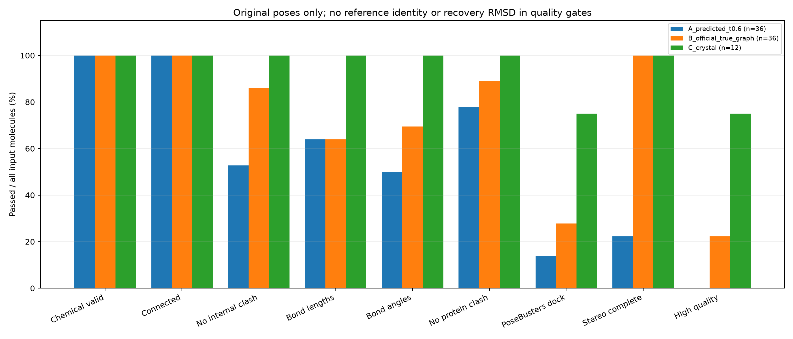
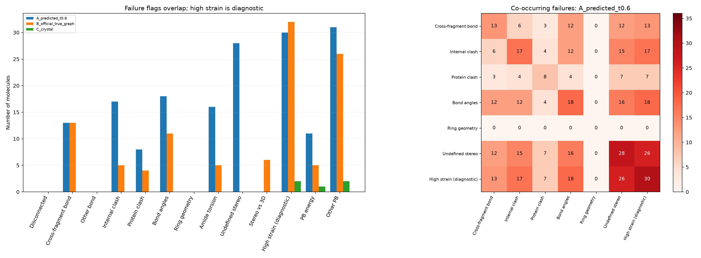

# SigmaDock de novo 分子生成质量评测

本轮评价 84 个已有结构。A_predicted_t0.6：36个结构、12个口袋；B_official_true_graph：36个结构、12个口袋；C_crystal：12个结构、12个口袋。

A为t=0.6普通预测，B为同口袋官方真实完整图全程采样，C为原始晶体配体，每个口袋只计一次。B为已知分子对接几何对照，任务难度与A不同。

**主要结果：** 预测组36/36化学有效且36/36完整连通，但17/36仍有严重分子内碰撞，13/36有跨片段异常键。PoseBusters dock通过5/36，按预设规则综合高质量0/36；这与参考配体是否恢复是不同问题。

主指标不要求生成分子等同参考配体。构造一致、参考Tanimoto和恢复RMSD仅在辅助列中报告。全部评测使用原始坐标，未重新采样、对接或训练；局部力场优化只产生独立诊断副本。

## 预先固定的规则与统计分母

运行前冻结的配置见[config_used.json](de_novo_quality_20261103/results/config_used.json)。综合高质量要求以下项目全部明确通过：化学有效、完整连通、分子内无严重碰撞、键长有效、键角有效、环几何有效、酰胺扭转有效、蛋白无严重碰撞、位于目标口袋、PoseBusters dock全通过、立体定义完整、已声明立体与三维一致。任何明确失败记fail；无明确失败但存在缺失记unavailable。主通过率为通过数/全部输入，另给可评价分母；missing不冒充通过或失败。分子内应变下降阈值、药物性质、结构警报、Vina分数和参考恢复均不参与综合筛选。

- 化学图：RDKit解析、sanitize、无dummy/自由基；连通率按重原子组分计。化学有效不等于三维有效。
- 原子碰撞：排除1–2成键对；1–3/1–4分别使用其RDKit化学/环拓扑距离下界，严重阈值为下界的0.70；1–5及更远/不同组分使用元素vdW半径和，严重阈值0.60。中等/轻度阈值分别为局部0.80/0.90和非局部0.75/0.85。碰撞类别互斥。
- 键长和角：使用RDKit DG化学、键级、局部拓扑和环约束的上下界，容差25%；角异常按两端原子距离界判断，同时记录实际角度。等价末端共轭键对称化；不使用全元素统一键长。
- 环与扭转：芳香环离最佳平面最大偏离≤0.25 Å，闭环键也按DG键长检查。重原子酰胺扭转偏离0/180°不超过30°；另保存ETKDG匹配扭转角，未对所有柔性转子强加单一角度阈值。PoseBusters还检查非芳香环非平面性和双键平面性。
- 蛋白：只对protein类型重原子距离<0.75×vdW半径和计蛋白严重碰撞；至少80%配体重原子距原口袋原子≤5 Å才记位于口袋。水不计自定义碰撞；有机辅因子使用vdW，无机辅因子按PoseBusters惯例使用共价半径，阈值均为0.75。金属原始vdW重叠保留作诊断，不将正常Zn/Mg配位误称为蛋白碰撞。PoseBusters另按标准测试水/辅因子。首个PDB model、同名原子最高占有率altloc；重原子测试忽略输入氢，不重新指定质子化。
- 原始预测图的手性从给定spec恢复，避免SDF读取从三维自动派生标签造成虚假“预测完整”。C晶体/无sidecar通用SDF报告读取后立体定义，不能据此推断模型是否显式预测了标签。

## 主要质量指标

| 检查 | A_predicted_t0.6 | B_official_true_graph | C_crystal |
| --- | ---: | ---: | ---: |
| SDF/SMILES解析 | 36/36 (100.0%)；fail=0，NA=0 | 36/36 (100.0%)；fail=0，NA=0 | 12/12 (100.0%)；fail=0，NA=0 |
| 化学有效 | 36/36 (100.0%)；fail=0，NA=0 | 36/36 (100.0%)；fail=0，NA=0 | 12/12 (100.0%)；fail=0，NA=0 |
| 完整连通 | 36/36 (100.0%)；fail=0，NA=0 | 36/36 (100.0%)；fail=0，NA=0 | 12/12 (100.0%)；fail=0，NA=0 |
| 分子内无严重碰撞 | 19/36 (52.8%)；fail=17，NA=0 | 31/36 (86.1%)；fail=5，NA=0 | 12/12 (100.0%)；fail=0，NA=0 |
| 键长有效 | 23/36 (63.9%)；fail=13，NA=0 | 23/36 (63.9%)；fail=13，NA=0 | 12/12 (100.0%)；fail=0，NA=0 |
| 键角有效 | 18/36 (50.0%)；fail=18，NA=0 | 25/36 (69.4%)；fail=11，NA=0 | 12/12 (100.0%)；fail=0，NA=0 |
| 环几何有效 | 36/36 (100.0%)；fail=0，NA=0 | 36/36 (100.0%)；fail=0，NA=0 | 12/12 (100.0%)；fail=0，NA=0 |
| 酰胺扭转有效 | 20/36 (55.6%)；fail=16，NA=0 | 31/36 (86.1%)；fail=5，NA=0 | 12/12 (100.0%)；fail=0，NA=0 |
| 立体定义完整 | 8/36 (22.2%)；fail=28，NA=0 | 36/36 (100.0%)；fail=0，NA=0 | 12/12 (100.0%)；fail=0，NA=0 |
| 已声明立体与三维一致 | 36/36 (100.0%)；fail=0，NA=0 | 30/36 (83.3%)；fail=6，NA=0 | 12/12 (100.0%)；fail=0，NA=0 |
| 蛋白无严重碰撞 | 28/36 (77.8%)；fail=8，NA=0 | 32/36 (88.9%)；fail=4，NA=0 | 12/12 (100.0%)；fail=0，NA=0 |
| 位于目标口袋 | 36/36 (100.0%)；fail=0，NA=0 | 35/36 (97.2%)；fail=1，NA=0 | 12/12 (100.0%)；fail=0，NA=0 |
| PoseBusters mol全通过 | 12/36 (33.3%)；fail=24，NA=0 | 20/36 (55.6%)；fail=16，NA=0 | 11/12 (91.7%)；fail=1，NA=0 |
| PoseBusters dock全通过 | 5/36 (13.9%)；fail=31，NA=0 | 10/36 (27.8%)；fail=26，NA=0 | 9/12 (75.0%)；fail=3，NA=0 |
| PB去除固定水检查（敏感性） | 9/36 (25.0%)；fail=27，NA=0 | 16/36 (44.4%)；fail=20，NA=0 | 11/12 (91.7%)；fail=1，NA=0 |
| 几何质量（不含立体/PB） | 8/36 (22.2%)；fail=28，NA=0 | 13/36 (36.1%)；fail=23，NA=0 | 12/12 (100.0%)；fail=0，NA=0 |
| 综合高质量 | 0/36 (0.0%)；fail=36，NA=0 | 8/36 (22.2%)；fail=28，NA=0 | 9/12 (75.0%)；fail=3，NA=0 |

## 三维几何、跨片段键与应变

| 组别 | 严重内碰撞对：中位/最大 | 跨片段异常键 / 全部跨片段键 | 最大键长偏差中位数 Å | 蛋白碰撞对中位数 | ΔE/重原子中位数 | 局部优化收敛 |
| --- | --- | --- | ---: | ---: | ---: | --- |
| A_predicted_t0.6 | 0.000 / 16.000 | 21 / 192；映射可用36/36 | 0.259 | 0.000 | 12.782 | 34/36 |
| B_official_true_graph | 0.000 / 7.000 | 16 / 192；映射可用36/36 | 0.289 | 0.000 | 5.851 | 33/36 |
| C_crystal | 0.000 / 0.000 | 0 / 0；映射可用0/12 | 0.099 | 0.000 | 1.227 | 12/12 |

所有逐键、逐角、碰撞对、最严重距离及vdW重叠、环与酰胺扭转明细保存在[JSONL](de_novo_quality_20261103/results/molecule_metrics.jsonl)和details/。跨片段/片段内标注仅来自保存的原始划分；C未核实原晶体原子顺序对应关系，故不猜测跨片段指标。

力场优先MMFF94s，缺参时用UFF；先保持全部重原子固定，只放松新增H，以原始重原子pose计算能量，再对克隆分子进行最多500次局部最小化。ΔE、优化位移及跨片段键长改变只用于诊断；不将不同分子绝对能量作为质量排名，不将优化后的结构计入原始通过率。未收敛保留实际状态，不声称得到全局最低能量。

| 组别 | 严重 / 中等 / 轻度内碰撞原子对总数 | 有金属原始vdW近接的分子（非蛋白碰撞） |
| --- | --- | ---: |
| A_predicted_t0.6 | 65 / 75 / 165 | 5 |
| B_official_true_graph | 14 / 17 / 84 | 9 |
| C_crystal | 0 / 0 / 3 | 3 |

## PoseBusters标准检查

主评价使用官方dock配置，不提供mol_true。mol列是同次运行中的分子自身标准检查子集；dock再加入受体距离、体积重叠和口袋距离等测试。redock/身份/RMSD类检查不进入主通过率。保持0.6.5官方阈值及50构象UFF能量对照，仅将能量计算线程固定为1，未使用fast模式。实际配置见[冻结的PoseBusters配置](de_novo_quality_20261103/results/posebusters_effective_config.json)，接口见[官方API](https://posebusters.readthedocs.io/en/latest/api.html)，标准实现见[dock配置](https://github.com/maabuu/posebusters/blob/main/posebusters/config/dock.yml)与[mol配置](https://github.com/maabuu/posebusters/blob/main/posebusters/config/mol.yml)。
全部通过要求所有标准布尔检查明确为True。表中每项为pass / fail / unavailable；缺少环、双键、水或辅因子时，相应“无违规”可由官方实现返回逻辑空集通过，表示没有可违规对象，不证明实际验证过该化学类型。非布尔能量/距离的NaN保留为空，不映射为True。

| 标准测试 | A_predicted_t0.6 | B_official_true_graph | C_crystal |
| --- | ---: | ---: | ---: |
| all_atoms_connected | 36 / 0 / 0 | 36 / 0 / 0 | 12 / 0 / 0 |
| aromatic_ring_flatness | 36 / 0 / 0 | 36 / 0 / 0 | 12 / 0 / 0 |
| bond_angles | 18 / 18 / 0 | 25 / 11 / 0 | 12 / 0 / 0 |
| bond_lengths | 23 / 13 / 0 | 23 / 13 / 0 | 12 / 0 / 0 |
| double_bond_flatness | 36 / 0 / 0 | 36 / 0 / 0 | 12 / 0 / 0 |
| inchi_convertible | 36 / 0 / 0 | 36 / 0 / 0 | 12 / 0 / 0 |
| internal_energy | 25 / 11 / 0 | 31 / 5 / 0 | 11 / 1 / 0 |
| internal_steric_clash | 22 / 14 / 0 | 31 / 5 / 0 | 12 / 0 / 0 |
| minimum_distance_to_inorganic_cofactors | 34 / 2 / 0 | 36 / 0 / 0 | 12 / 0 / 0 |
| minimum_distance_to_organic_cofactors | 36 / 0 / 0 | 36 / 0 / 0 | 12 / 0 / 0 |
| minimum_distance_to_protein | 28 / 8 / 0 | 32 / 4 / 0 | 12 / 0 / 0 |
| minimum_distance_to_waters | 11 / 25 / 0 | 20 / 16 / 0 | 10 / 2 / 0 |
| mol_cond_loaded | 36 / 0 / 0 | 36 / 0 / 0 | 12 / 0 / 0 |
| mol_pred_loaded | 36 / 0 / 0 | 36 / 0 / 0 | 12 / 0 / 0 |
| no_radicals | 36 / 0 / 0 | 36 / 0 / 0 | 12 / 0 / 0 |
| non-aromatic_ring_non-flatness | 36 / 0 / 0 | 36 / 0 / 0 | 12 / 0 / 0 |
| protein-ligand_maximum_distance | 36 / 0 / 0 | 36 / 0 / 0 | 12 / 0 / 0 |
| sanitization | 36 / 0 / 0 | 36 / 0 / 0 | 12 / 0 / 0 |
| volume_overlap_with_inorganic_cofactors | 36 / 0 / 0 | 36 / 0 / 0 | 12 / 0 / 0 |
| volume_overlap_with_organic_cofactors | 36 / 0 / 0 | 36 / 0 / 0 | 12 / 0 / 0 |
| volume_overlap_with_protein | 36 / 0 / 0 | 36 / 0 / 0 | 12 / 0 / 0 |
| volume_overlap_with_waters | 35 / 1 / 0 | 36 / 0 / 0 | 12 / 0 / 0 |

每项比例及可评价分母见[posebusters_tests.csv](de_novo_quality_20261103/results/posebusters_tests.csv)。失败原因为每分子evaluation.log、errors和PoseBusters errors；未完成项目保留unavailable。

固定晶体水对de novo分子尤其敏感：新结构可能置换原结合水，固定水碰撞不能独立证明分子不可结合。因此另列“PB去除固定水检查”敏感性指标，只从同次标准输出中去掉minimum_distance_to_waters和volume_overlap_with_waters，不改任何阈值、不重跑pose，也不替代官方整体通过率或综合高质量定义。

## 蛋白相容性和可选score-only

使用与模型输入相同的原口袋PDB，因此结论限于这些口袋原子，不能排除与完整蛋白其他区域的碰撞。保存极性原子近邻和疏水接触距离计数，不将其称作已验证的定向氢键。质子化、H方向、缺失侧链及溶剂暴露未经独立重建，埋藏未满足极性基团和严格氢键数量为unavailable。

Vina只对原始pose调用score()，不调用optimize()/dock()。复用已准备PDBQT，记录histidine/备用准备来源；核对与评价蛋白的重原子坐标重合率≥99%，以及配体准备前后重原子位置差≤0.002 Å。盒中心来自输入口袋，24 Å边长；出盒/缺参/准备失败均记unavailable，不重新放置或对接。Vina及Meeko版本见protocol.json，其分数只是辅助数值，不代表实验亲和力。

| 组别 | Vina状态 | score中位数 kcal/mol | 可评分数 |
| --- | --- | ---: | ---: |
| A_predicted_t0.6 | {'ok': 33, 'unavailable': 3} | -5.511 | 33/36 |
| B_official_true_graph | {'ok': 33, 'unavailable': 3} | -6.593 | 33/36 |
| C_crystal | {'ok': 11, 'unavailable': 1} | -8.025 | 11/12 |

## 性质、多样性与有效产量

标准化规则：RDKit Cleanup + canonical SMILES, atom maps removed, retain components/charge/stereo; no tautomer collapse or neutralization. Morgan radius=2/2048 bits, chirality off for structural similarity.

| 组别 | 有效连通分子 | 有效唯一立体结构 / 二维构造 | 唯一立体结构 / 全部输入 | 每口袋有效唯一立体结构均值 | 每口袋高质量唯一结构均值 | 全部输出成对Tanimoto均值 |
| --- | ---: | --- | --- | ---: | ---: | ---: |
| A_predicted_t0.6 | 36 | 29 / 29 | 29/36 | 2.417 | 0.000 | 0.143 |
| B_official_true_graph | 36 | 12 / 12 | 12/36 | 1.000 | 0.333 | 0.169 |
| C_crystal | 12 | 12 / 12 | 12/12 | 1.000 | 0.750 | 0.118 |

| 组别 | MW | LogP | QED | TPSA | HBD / HBA | 可旋转键 | 环 / 芳环 | 重原子 | 形式电荷 |
| --- | ---: | ---: | ---: | ---: | --- | ---: | --- | ---: | ---: |
| A_predicted_t0.6 | 384.932 | 2.557 | 0.369 | 94.280 | 2.000 / 4.000 | 6.000 | 4.000 / 3.000 | 26.500 | 0.000 |
| B_official_true_graph | 384.932 | 3.006 | 0.355 | 93.480 | 3.000 / 4.000 | 6.500 | 4.000 / 3.000 | 26.500 | 0.000 |
| C_crystal | 384.931 | 3.006 | 0.355 | 93.480 | 3.000 / 5.500 | 7.500 | 4.000 / 3.000 | 26.500 | 0.000 |

性质表为全部有效输出的中位数，完整均值、范围及5%/95%分位见summary.json。

| 组别 | 不在所提供训练二维集合中的输出 / 全部 | 此类唯一二维构造 | 不可评价 |
| --- | --- | ---: | ---: |
| A_predicted_t0.6 | 36/36 | 29 | 0 |
| B_official_true_graph | 27/36 | 9 | 0 |
| C_crystal | 9/12 | 9 | 0 |

[pocket_yields.csv](de_novo_quality_20261103/results/pocket_yields.csv)列出每个口袋的有效唯一和高质量唯一产量；[conformer_diversity.csv](de_novo_quality_20261103/results/conformer_diversity.csv)仅对同口袋、相同标准化立体结构的多个输出报告对称感知对齐RMSD及受体坐标系RMSD，区分化学多样性与构象/摆位多样性。相似度分布同时给出全部输出与唯一二维构造两种分母；超出max_pairs才用固定seed抽样。MW、LogP、QED、TPSA、HBD/HBA、可旋转键、环、芳环、重原子和形式电荷逐分子及分组分布均已保存。

训练结构新颖性：`{"status": "ok", "scope": "Actual 17420-member PDBBind-stage training set of the legacy checkpoint; GEOM pretraining, connection-head and official SigmaDock training are not included.", "path": "/home/zhouwanyao/drive_download/releases/casf_paired_eval/de_novo_quality_20261103/training_index.json", "sha256": "984dbd4deeb1d8e2d3ee77c4cf669b0134630f7a9408933c743b1677af00ce08", "unique_isomeric": 14103, "unique_constitution": 13683, "invalid_or_missing_records": 0, "full_training_universe_covered": false}`。仅对实际提供的训练结构集合计算“不在该集合”的比例；本轮若只提供PDBBind阶段成员，不能声称已覆盖GEOM预训练、连接头或官方SigmaDock的所有训练结构。不同于当前参考配体是另外的辅助指标，不等于训练新颖。

## 失败原因及重叠

| 原因 | A_predicted_t0.6 | B_official_true_graph | C_crystal |
| --- | ---: | ---: | ---: |
| Disconnected | 0 | 0 | 0 |
| Cross-fragment bond | 13 | 13 | 0 |
| Other bond | 0 | 0 | 0 |
| Internal clash | 17 | 5 | 0 |
| Protein clash | 8 | 4 | 0 |
| Bond angles | 18 | 11 | 0 |
| Ring geometry | 0 | 0 | 0 |
| Amide torsion | 16 | 5 | 0 |
| Undefined stereo | 28 | 0 | 0 |
| Stereo vs 3D | 0 | 6 | 0 |
| High strain (diagnostic) | 30 | 32 | 2 |
| PB energy | 11 | 5 | 1 |
| Other PB | 31 | 26 | 2 |

各原因可同时出现；高应变是辅助旗标，不自动拒绝原始样本。PoseBusters其他失败可能与逐键/碰撞检查重复，不将各项之和当作失败分子数。

## 本轮问题回答

- **不连通问题**：36/36 个图完整连通，失败0、不可评价0。这是本批图层面的结论；空间上长键或片段分离仍由几何检查单独识别。
- **分子内碰撞**：17/36 存在自定义严重碰撞，PoseBusters内碰撞通过率另见标准表；不能由sanitize或连通性推断其已解决。
- **新建跨片段键**：13/36 个分子至少一条跨片段键异常；总计21/192条异常。
- **口袋内合理性**：蛋白无严重碰撞28/36、位于口袋36/36；几何组合通过8/36。距离接触不能证明结合亲和力。
- **PoseBusters整体通过率**：dock为5/36（13.9%），fail=31、unavailable=0。
- **每口袋产量**：本次每口袋只生成3个seed；平均高质量且结构不同产量为0.000，化学有效连通唯一结构均值为2.417，二者不能混用。
- **主要失败模式**：Undefined stereo=28/36、Bond angles=18/36、Internal clash=17/36、Amide torsion=16/36、Cross-fragment bond=13/36；参见重叠图，不以参考构造错误给de novo分子判质量失败。
- **改进优先级（由本批现象推断）**：优先加强跨片段化学几何约束与连接—坐标耦合，包括键长/角度、非键排斥、酰胺平面性和附着后立体输出。本批全部21条异常键均为跨片段键，片段内975条键无异常；图层面的不连通已不是主要失败模式。
  官方真图对照也有13/36个分子存在跨片段异常键，说明只提高连接图正确率不足以解决全部几何问题。应并行定位片段模板/接口与几何扩散中的边界约束，再决定模型改进；不能把全部差异归因于连接搜索或主干。本轮仅评价，不修改或训练模型。

5个通过PB dock的预测中，4个与参考配体二维构造不同，仍然通过标准物理检查，说明恢复率不能替代de novo质量评价。其未达到综合标准的原因包括4个缺失立体定义、2个酰胺平面性越界（可重叠）；这些是预设额外条件，PB自身没有要求恢复参考手性。

## 辅助参考恢复诊断

| 组别 | 构造一致 | 立体一致 | 构造一致RMSD<2 Å | 严格RMSD<2 Å |
| --- | ---: | ---: | ---: | ---: |
| A_predicted_t0.6 | 1 | 0 | 1 | 0 |
| B_official_true_graph | 36 | 36 | 25 | 25 |
| C_crystal | 12 | 12 | 12 | 12 |

不同二维构造的恢复RMSD留空；不将固定槽位原子RMSD或参考分子相似性混入质量通过率。

## 可复现性、限制和产物

- [逐分子CSV](de_novo_quality_20261103/results/molecule_metrics.csv)、[完整逐分子JSONL](de_novo_quality_20261103/results/molecule_metrics.jsonl)、[summary.json](de_novo_quality_20261103/results/summary.json)、[failure_analysis.csv](de_novo_quality_20261103/results/failure_analysis.csv)。
- [输入manifest](de_novo_quality_20261103/results/manifest_used.json)、[配置](de_novo_quality_20261103/results/config_used.json)、[版本、源码与参数指纹](de_novo_quality_20261103/results/protocol.json)、[Top-K统计](de_novo_quality_20261103/results/top_k_summary.csv)。cache/以输入内容、计算源码、版本及完整配置为键，支持断点与重复评价；不需要重新生成分子。
- [三维示例索引](de_novo_quality_20261103/results/examples/index.json)：每例保留原始SDF副本、受体PDB、PyMOL脚本和交互HTML；HTML使用3Dmol.js，PyMOL文件可离线查看。没有达到综合标准的组只展示明确标记为失败的相对较好/较差样本。
- 若输入为本轮SWITCH对照：受控测试给定真实片段身份、N及OOV结构，CASF曾用于旧权重选择，仅12个口袋×3seed，不代表自由身份/N生成或独立盲测。同一口袋多个seed不视作独立受体。
- 化学/几何阈值是明确的操作性筛选，不等价于可合成性、毒性、安全性或实验活性。结构警报仅为描述。配置在批量运行前固定，不按这批通过率回调。
