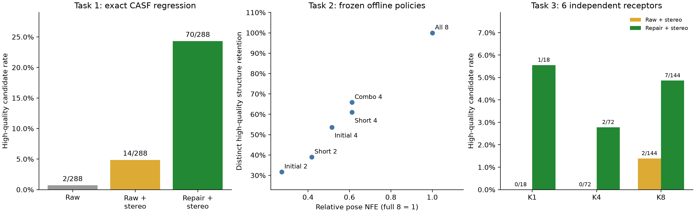

# 任务一至三最终报告索引与结论

报告日期：2026-11-04。此次范围为任务一至三；任务四已有产物单独保留，不纳入下列结论或费用。

| 任务 | 最终报告 | 主要结果 |
|---|---|---|
| 一：统一管线 | [PIPELINE_BASELINE.md](PIPELINE_BASELINE.md) | 完整回归 70/288 HQ、41 个受体内去重构造；288 个最终输出坐标及立体图一致；支持 K1/4/8 且新输入已实际运行 |
| 二：低成本筛选 | [EARLY_CANDIDATE_SELECTION_RESULTS.md](EARLY_CANDIDATE_SELECTION_RESULTS.md) | 短程 Top-4 节省 38.8% 姿态 NFE，保留 50.0% HQ 候选及 61.0% 不同构造；单位构造 NFE 581.8，对照全8为 579.5 |
| 三：独立泛化 | [INDEPENDENT_GENERALIZATION_RESULTS.md](INDEPENDENT_GENERALIZATION_RESULTS.md) | 6 受体、18 尝试；同等立体赋值下修复使 HQ 2/144→7/144，不同构造 1→6；实际 K8 研究墙钟 2,030.324 秒 |

当前 Top-K 简单筛选没有实现显著降本且低损失保留高质量产量。固定组合 Top-4 虽保留 27/41 构造，但仅保留 34/70 HQ；其约 7% 的单位构造 NFE 改善不足以证明可普遍替代全8。

末端几何修复的局部改善在独立小样本重现，但独立最终 HQ 率 4.86%，低于 CASF 24.31%。受体聚类的 K8 配对提升描述性 95% 区间为 +0.69 至 +6.25 个百分点；6 个受体、1 个开发口袋不足以确立广泛泛化。严格 PB 水相关检查仍明显限制绝对通过率，主结果没有放宽门槛。

实际候选均为跨片段单键，双键/E/Z 生成和跨片段环连接仍未被验证；源配体有 E/Z 不能替代实际候选化学覆盖。真实身份、N 和配体邻域口袋仍是 Oracle，不能把这些结果外推为自由 de novo 能力。

仅凭任务一至三不能判断是否必须把约束加入每一步 SE(3) 扩散；这需要任务四或新的配对干预证据。本次证据支持先保留完整 Top-8 与末端修复作为质量基线，再用新的独立训练/验证集研究最终质量排序，并扩大外部样本及化学覆盖。解除身份与 N 应单独分阶段评价。



可导出图：[PNG](tasks123_overview.png)、[PDF](tasks123_overview.pdf)。核验：[tasks123_verification.json](tasks123_verification.json)；范围内费用：[tasks123_compute_ledger.csv](tasks123_compute_ledger.csv)；全实验原费用：[compute_ledger.csv](compute_ledger.csv)。任务一至三新增姿态 NFE 总计 13,860；反事实 K1/4 不再次计费，任务四费用未混入。

逐候选、逐受体、受体聚类区间、配置与命令在各主报告中链接。

仅重建报告和核验（不采样、不训练）：

```bash
bash fbdd_efficiency_generalization_20261103/reproduce_tasks123_reports.sh
```
