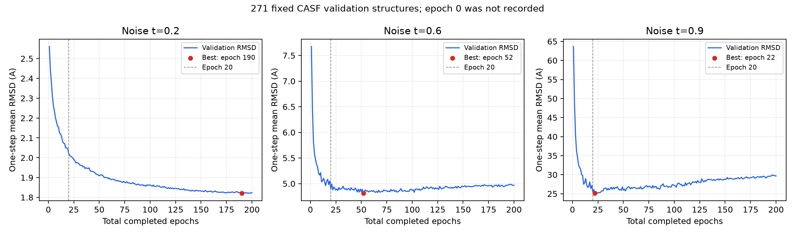

# 200 epoch 训练 RMSD 审计

第 0 轮验证未保存，不能把第 1 轮或输入噪声 RMSD 冒充训练前模型表现。以下是已保存的第 1 轮与第 200 轮，以及最佳轮次对比。当前训练从 GEOM 预训练开始，跨三个目录续跑，累计共 200 轮。

| 噪声 t | 第 1 轮 Å | 第 200 轮 Å | 下降 Å | 下降比例 | 最佳轮次 | 最佳 RMSD Å |
|---|---:|---:|---:|---:|---:|---:|
| 0.2 | 2.5610 | 1.8232 | 0.7378 | 28.81% | 190 | 1.8206 |
| 0.6 | 7.6761 | 4.9656 | 2.7105 | 35.31% | 52 | 4.8119 |
| 0.9 | 63.6702 | 29.6607 | 34.0095 | 53.42% | 22 | 25.1303 |

t=0.6 在第 11 轮达到“第 1 轮至最终观测最佳值”改善量的 90%，第 20 轮达到约 97.1%；约第 20–30 轮后进入平台。第 52 轮最佳 4.8119 Å，200 轮为 4.9656 Å，较最佳回升约 3.19%。第 100 轮以后整体缓慢回升。这里的平台判断为曲线描述，不是精确变点检验。

t=0.2 仍持续缓慢改善，最佳出现在第 190 轮；但第 100→200 轮只改善约 0.0388 Å。t=0.9 最佳为第 22 轮，之后整体回升，不能将不同噪声时刻合并成一个 RMSD 改善结论。

当前管线实际选用按验证总损失挑选的第 198 轮 `best_loss.pt`，其 t=0.6 RMSD 为 4.9759 Å；按该 RMSD 选出的最佳模型在第 52 轮。最低 loss 与最低 RMSD 并非同一检查点。

验证对象为固定的 271 个 CASF 结构，噪声 t=0.2/0.6/0.9，指标为受体坐标系下、不对齐的单步去噪 RMSD。不是完整反向扩散 docking RMSD，也不是独立测试结果。输入 noisy RMSD 在所有轮次相同，但它表示待去噪坐标，不表示训练前模型成绩。

完整逐轮数据见 `rmsd_by_epoch.csv`，来源指纹与分段均值见 `summary.json`；脚本 `analyze.py` 仅读取原训练日志，不启动训练或重新生成分子。
