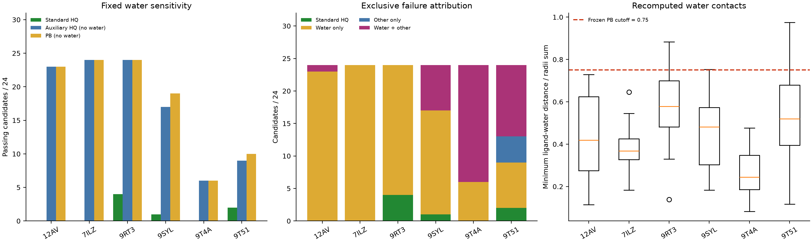

# 独立测试诊断交付

日期：2026-11-04；对应 `prompt_11041031.md`。沿用全部冻结模型与主评测门槛，本轮新神经NFE=0。

- [水失败审计](WATER_FAILURE_AUDIT.md)：144个候选、79个水原子逐项复算；6个晶体配体均通过原PB。133/144失败于水距离，水体积检查全部通过。
- [失败归因](INDEPENDENT_FAILURE_ANALYSIS.md)：标准HQ=7/144；不计水PB=106/144；不计水辅助HQ=103/144。96个仅被水阻断，37个水与其他问题并存，4个仅其他问题。
- [晚期约束复核](LATE_GUIDANCE_REVIEW.md)：原有18个rank-1测试未显示严格HQ优势；三次离散投影不能代表持续或每步约束，本轮未重复实验。
- [扩大独立评测方案](GENERALIZATION_EXPANSION_PLAN.md)：披露查询分页、抓取上限、输入失败；提出20开发＋60新测试的预锁定方案，以及非单键/EZ与不支持成环的分层覆盖。

主要判断：固定水距离检查是当前最终严格通过率的主要直接阻断项；同时9T4A的内部碰撞/键角、9T51的跨片段键长是真实残余限制。原始几何缺陷经末端修复明显减少，不能因此忽视修复贡献。OOV与模板误差有受体间关联，但未证明因果；6个晶体参考全部相容，未发现准备坐标错误。准备脚本丢失原B因子，本次已从原mmCIF恢复用于注释。

下一轮优先单项对照：保持候选、固定水、神经模型和主评测不变，配对比较当前末端修复与考虑水排斥的实验末端修复。先在新开发输入固定实验参数，不以本轮测试标签调参。该对照可不重跑神经轨迹；本轮仅提出方案，未执行。

标准HQ仍为7/144；辅助指标不作为重命名后的主结果。Oracle身份、N和配体邻域口袋仍保留。没有确立自由de novo、实际双键/EZ或跨片段环生成能力。所有原模型、阈值与既有报告均保持原记录；本文件夹提供追加诊断。

数据导航：`water_catalog.csv`、`water_atom_contacts.csv`、`ligand_water_pairs.csv`、`water_molecule_audit.csv`；`candidate_failure_metrics.csv`、`geometric_details.csv`、`PB_tests_per_molecule.csv`、`pocket_failure_summary.csv`；`exclusive_failure_attribution.csv`；`crystal_reference_controls.csv`；`late_*`；`cohort_screening_funnel.csv`、`inventory_exclusion_reasons.csv`、`source_preparation_outcomes.csv`、`ligand_copy_completeness.csv`。配置在 `configs/` 和 `diagnostic_config.json`；不可变输入指纹在 `source_fingerprints.json`；最终核验在 `verification.json`。

复现（无神经采样）：`bash independent_diagnostics_20261104/reproduce.sh`。导出图：`diagnostic_overview.png`、`diagnostic_overview.pdf`。
