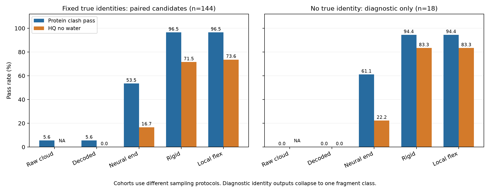

> GitHub 精简归档：保留报告、源码、固定参数、关键汇总与核验。完整结构、QC缓存、逐原子明细及完整指纹留在原本地工作区；复现需要原项目依赖。本文仅调整归档链接与此范围说明，实验结论和数值不变。

# SigmaDock-FBDD 无结晶水协议与生成质量严肃评估

日期：2026-11-05。评估任务：[原始 prompt](prompt.md)。本报告区分历史条件生成的配对证据与新增无真实身份诊断；不把后处理结果记作网络直接能力。

## 1. 主要判断

**当前历史生成入口仍依赖真实片段身份和真实片段数。其修复后 HQ 不能作为自主 de novo 成功率。** 144 个历史候选的神经续采样终点只有 24/144（16.7%）通过 `HQ_no_water`，刚性与局部柔性修复后分别为 103/144（71.5%）、106/144（73.6%）。蛋白碰撞通过率为 77/144 → 139/144，局部柔性没有进一步增加通过候选数。

实际模型口袋此前已无水，故复用历史候选合理；历史原始 PDB 则确实保留水。本次建立了真实去水、保留非水环境的文件，并重新执行完整 QC，移除的仅是两项水检查。**新协议下的 103/144 与旧含水严格 HQ 7/144 是不同口径，不能记为模型进步。** 旧报告与原始输入保持原样。

另以现有固定权重加最小推理适配器做了 18 次无真实身份条件的诊断：90 个槽位全部输出苯类别，最终只有一种分子构造。虽然修复后 15/18 通过 HQ，这不能证明有多样、受体特异的生成能力。该诊断不是对所有可能自由采样策略的否定，也不是完整自主生成基准。

## 2. 数据、分母及阶段定义

主队列为 6 个受体 × 3 个种子 × 8 个连接候选 = **144**；全部候选保留。18 次前段轨迹各共享给八个连接候选，原始未连接点云实际上只有 **18 份**。其通过率 8/144 等价于 1/18，不能当作 144 次独立神经采样。

来源范围也需披露：历史筛得15个严格候选，先按预定范围排除4个（含9YEB金属依赖辅因子系统），余11个进入准备；其中9QJF、9SOD、34JY缺失配体重原子，9TAR为共价系统，4/11准备失败；7个成功中1个用于开发、6个用于本次测试。故0/144只表示已锁定六受体队列中的技术失败率，不表示15个来源系统全部成功，亦不能外推到被排除的共价/辅因子体系。见 [上游流失记录](upstream_attrition.json)。

1. `raw_predecode`：历史模型前段 t=.98→.6 的未连接片段点云，20 次位姿网络计算；身份和槽位数为真实条件。
2. `decoded_initial`：在相同 t=.6 坐标上赋予预测连接图；不作几何修复。解码只改变图，不能凭空改善空间碰撞。
3. `native_final`：固定候选图后，官方位姿网络再执行 16+64=80 次步骤至 t=.02；几何推导立体标签，不做 MMFF 修复。这一额外阶段使“连接搜索”和“解码后的神经运动”不会混算。
4. `rigid`、`local_flex`：均独立从同一个 `native_final` 起点修复，后者不是在刚性修复结果上再优化。两者均无固定水排斥。

所有完整分子使用相同 SDF 序列化和几何推导立体化学方法。所有碰撞在原始蛋白坐标系中计算，不作对齐。原始未连接输出只报告重原子空间指标，化学图依赖的 HQ、连通、键角检查为 **NA，而不是失败或通过**。

## 3. 水与辅因子全链路审计

| 受体 | 原始水重原子 | 去水环境重原子 | 实际模型重原子 | 保留的非水辅因子 |
| --- | --- | --- | --- | --- |
| 12AV | 21 | 196 | 196 | {} |
| 7ILZ | 4 | 63 | 59 | {'organic_cofactor': 4} |
| 9RT3 | 12 | 186 | 186 | {} |
| 9SYL | 21 | 205 | 205 | {} |
| 9T4A | 15 | 191 | 184 | {'organic_cofactor': 4, 'inorganic_cofactor': 3} |
| 9T51 | 6 | 269 | 269 | {} |

合计移除 79 个水重原子，保留全部 11 个非水辅因子重原子。`pockets/*_no_water.pdb` 的非水原子元素、坐标、分类和顺序与原始环境逐项相等。原始 PDB、源 mmCIF、配体及模型文件未改写，路径和 SHA-256 可追溯。

实际调用链证据：`prepare_sources.py` 写入含水原始口袋；官方 `get_protein/prune_structure` 默认去水并去 HETATM，`SigmaDataset.parse_complex` 断言无水；`prepare_fixtures.py` 将处理后的 pocket 构成官方和历史模型共享的 protein_graph；`legacy_prefix.py` 覆盖历史 record 中的蛋白图。此处不是仅相信断言：六个 fixture 分子、六个共享蛋白张量和 **144 个实际 native graph.pt** 的蛋白坐标均逐项核验一致且无水，见 [实际图审计](actual_native_graph_audit.json)。连接解码不读取晶体水；刚性与局部柔性修复的蛋白项均排除 water。

**辅因子限制必须保留：** 官方预处理此前也排除了非水 HETATM，故 7ILZ 的 4 个、9T4A 的 7 个辅因子原子虽保留在本次环境、碰撞 QC 和修复中，却未被历史位姿网络感知。本次没有悄悄向模型强塞未支持的辅因子节点。新无水文件完整保留辅因子，不能据此声称模型已具备辅因子条件化能力。协议是可复现的无水基线；“模型同时感知必要辅因子”仍是未满足能力。

## 4. 冻结的质量标准

PoseBusters dock 配置只删除 `minimum_distance_to_waters`、`volume_overlap_with_waters` 对应模块；其余 **20 项二元输出及模块参数完全保留**。50 构象 UFF 能量参照、ETKDG seed=42、能量线程数 1 沿用原设置，不跳过能量、不放宽阈值。完整配置差分见 [原配置](posebusters_original.json)、[无水配置](posebusters_no_water.json)。

`HQ_no_water` 是原有 12 个必要条件的合取，只将 PB 全通过替换为剩余非水项全通过；缺失项不能当作通过。统一蛋白碰撞标准为 ligand-heavy/protein-heavy 的 `distance / (r_vdw_ligand + r_vdw_protein) < 0.75`，任一严重对即失败。水不参与；蛋白之外的有机/无机辅因子仍由原有独立标准与 PB 检查。键与角的界限容差 .25、内部局部严重比值 .7、远程 .6、环平面 .25 Å、酰胺 30°均未改变。

冻结文件见 [protocol.json](protocol.json)、[quality_config.json](quality_config.json)、[NO_WATER_PROTOCOL.md](NO_WATER_PROTOCOL.md)。水排斥分支 A1 不进入本次主实验，也没有继续开发。

## 5. 同候选的主结果：条件生成，不能冒充自由生成

| 阶段 | 蛋白碰撞通过 | HQ_no_water | 化学有效 | 连通 | 异常键数 | 异常角数 |
| --- | --- | --- | --- | --- | --- | --- |
| 原始未连接点云 | 8/144 (5.6%) | NA：无完整图 | NA | NA | NA | NA |
| 连接解码起点 | 8/144 (5.6%) | 0/144 (0.0%) | 144/144 (100.0%) | 144/144 (100.0%) | 470 | 1442 |
| 神经续采样终点 | 77/144 (53.5%) | 24/144 (16.7%) | 144/144 (100.0%) | 144/144 (100.0%) | 138 | 175 |
| 刚性修复 | 139/144 (96.5%) | 103/144 (71.5%) | 144/144 (100.0%) | 144/144 (100.0%) | 12 | 51 |
| 局部柔性修复 | 139/144 (96.5%) | 106/144 (73.6%) | 144/144 (100.0%) | 144/144 (100.0%) | 12 | 34 |

异常键/角是全部候选的异常条目总数，不是失败分子数。各完整阶段均有 144 条记录，无生成、解析或处理异常导致的候选删减。化学有效和连通的 100% 来自词表模板、价态限制及合法连接搜索，不能解释为网络原始无约束输出有 100% 化学正确率。搜索过程中未被选中的内部假设不属于另行承诺的 144 次生成尝试；本分母不能用来估计无搜索的原始连接头成功概率。

| 检查 | 连接解码起点 | 神经续采样终点 | 刚性修复 | 局部柔性修复 |
| --- | --- | --- | --- | --- |
| no_severe_internal_clash | 0/144 (0.0%) | 81/144 (56.2%) | 130/144 (90.3%) | 143/144 (99.3%) |
| bond_geometry_valid | 0/144 (0.0%) | 74/144 (51.4%) | 132/144 (91.7%) | 132/144 (91.7%) |
| angle_geometry_valid | 0/144 (0.0%) | 82/144 (56.9%) | 118/144 (81.9%) | 119/144 (82.6%) |
| torsion_geometry_valid | 107/144 (74.3%) | 129/144 (89.6%) | 144/144 (100.0%) | 144/144 (100.0%) |
| stereo_definition_complete | 108/144 (75.0%) | 129/144 (89.6%) | 140/144 (97.2%) | 144/144 (100.0%) |
| stereo_geometry_consistent | 144/144 (100.0%) | 144/144 (100.0%) | 144/144 (100.0%) | 144/144 (100.0%) |
| posebusters_all_pass | 0/144 (0.0%) | 28/144 (19.4%) | 106/144 (73.6%) | 106/144 (73.6%) |

神经续采样把蛋白通过数从 8 提高到 77，净增 69；刚性修复再增加 62。就 HQ 而言，神经终点 24 个通过，刚性修复净增 79，局部柔性相对同一起点净增 82。局部柔性与刚性之间 **4 个获得通过、1 个丢失通过，净增 3**；不能说全部候选都更好。解码起点与原始点云的蛋白严重碰撞对数对全部 144 个候选完全相同。

内部严重碰撞对数依次为 24879 → 196 → 15 → 1；蛋白严重碰撞对数为 3432 → 97 → 8 → 7。刚性与柔性的 12 条残余异常键均为跨片段键，片段内部异常键均为 0。异常角仍有 51/34 条，表明连接区几何仍未解决。

唯一一条 PB 不可评估项是 `decoded_initial__7ILZ_1801_08` 的 internal_energy，标准计算未得到有限的通过值；原样记为 NA，其他多项已失败，HQ 为 False。没有跳过能量或删除该候选，见 [不可评估记录](PB_unavailable_records.json)。

## 6. 受体差异与配对解释

| 受体 | 网络蛋白 | 网络HQ | 刚性蛋白 | 刚性HQ | 柔性蛋白 | 柔性HQ |
| --- | --- | --- | --- | --- | --- | --- |
| 12AV | 14/24 | 1/24 | 24/24 | 23/24 | 24/24 | 22/24 |
| 7ILZ | 24/24 | 11/24 | 24/24 | 24/24 | 24/24 | 24/24 |
| 9RT3 | 18/24 | 10/24 | 24/24 | 24/24 | 24/24 | 24/24 |
| 9SYL | 4/24 | 1/24 | 23/24 | 17/24 | 23/24 | 19/24 |
| 9T4A | 9/24 | 0/24 | 23/24 | 6/24 | 23/24 | 7/24 |
| 9T51 | 8/24 | 1/24 | 21/24 | 9/24 | 21/24 | 10/24 |

主要困难集中在 9T4A、9T51；即使修复后的蛋白碰撞通过，其他几何项仍可使 HQ 失败。只有六个受体，种子和同一连接池中的候选相关，因此不把 144 当作独立样本做显著性宣称。逐候选和逐受体结果完整输出，不挑选最好种子、最好受体或只保留收敛样本。

## 7. 坐标变化、收敛和立体化学

| 处理 | 相对网络终点平均RMSD/Å | 候选RMSD最大/Å | 任一原子最大位移/Å | 优化收敛 |
| --- | --- | --- | --- | --- |
| 刚性修复 | 0.4605 | 1.0406 | 2.1105 | 118/144 |
| 局部柔性修复 | 0.4469 | 1.0165 | 2.1037 | 110/144 |

前段解码起点至神经终点平均重原子 RMSD 为 5.4740 Å；这段运动属于后续 80 次位姿网络计算。柔性与刚性结果之间平均 RMSD 为 .0564 Å、最大候选 RMSD 为 .4680 Å。柔性局部附加自由度的上限为 .10 Å，但整体刚体也会调整，因此 .10 Å 不是总原子位移上限。未收敛的刚性 26/144、柔性 34/144 均保留，继续按原坐标接受 QC，不将未收敛自动判成通过或从分母删除。

所有阶段统一根据几何生成立体标签；这项规则是读出/后处理，而非网络显式预测的立体化学准确率。与网络终点相比，刚性修复有 4 个原可靠判定丢失、16 个恢复；柔性为 0 丢失、16 恢复。柔性与刚性之间另有 1 个双方均可靠的立体描述变化，4 个可靠判定恢复。`stereo_geometry_consistent` 的 144/144 表示标签与自身坐标一致，不代表与真实目标的立体构型相同。细节保留于逐候选 JSON/CSV 与 stereo_decisions.json。

## 8. 多样性及其来源

四个完整阶段均有 93 种构造，构造唯一比例 93/144=64.6%，Morgan radius=2、2048 bits 的平均 1−Tanimoto 为 .8371。解码起点/网络终点/刚性/柔性的含立体标签唯一 SMILES 数分别为 122/103/103/100；其变化来自坐标推导标签，而不是产生了新分子构造。

这些 93 种构造来自**给定真实片段身份后的连接搜索**，不能当作 3684 词表自主身份探索证据。跨受体混合的指纹多样性也容易被不同真实片段组成抬高；每个受体、相同图的构象 RMSD 分布另存于 summary.json 的 conformer_groups。未做受体/对称性对齐的位移与做了最佳对齐的构象差异分开记录。新颖性、结合活性、受体选择性与实验有效性未由此证明。

## 9. 当前推理代码到底支持什么

历史 `native_generate.py` 直接从 fixture 读取 labels/oov，并以固定片段数和这些身份构造 ConnectionRuntime、分子图。它支持预测连接及三维位姿，**不在 3684 类中自由选择身份**。历史图和前段初始化还依赖真实配体定义的口袋位置/COM，因此也不是从未知结合位点开始的自主搜索。

仓库另有 `sample_joint(profile='joint')` 的原型，具备频率先验身份初始化、迭代身份建议及图重建；不能笼统说整个仓库完全没有自由生成代码。但它依赖较早的 PortConnectionPredictor 接口；当前主队列使用 TimeConnectionPredictor/ConnectionRuntime，尚未由历史评测入口贯通。旧 identity_server 还通过验证集 ID 查取记录，不能直接处理本次外部受体。显式给定 slots 时可避免真实片段数条件，但不具备经验证的片段数生成模型。

本次新增 `free_identity_server.py` 仅从给定 T/R 创建全 MASK、无蛋白的 GEOM 输入，完全去掉 dataset/target record 查取；`free_probe.py` 以现有 GEOM 身份头、当前 robust 连接头和官方位姿权重组成最小诊断适配器。新增的是推理连接代码，没有训练新权重。其身份头本身不读取蛋白，是当前能力的重要缺口。完整说明见 [CAPABILITY_AUDIT.md](CAPABILITY_AUDIT.md)。

## 10. 独立无真实身份诊断：18 次全部保留

固定六个受体、三个种子、每次五个槽位；五不是读取真实片段数所得。没有真实身份、真实连接、目标立体标签或目标坐标输入。仅保留历史已知口袋的空间位置。采用既有身份头的一次全 MASK top1（t=1），当前连接头宽搜索取一个候选，官方 25 点三次网格执行 24 步，再独立做两种修复。该策略先于输出冻结，没有试多个参数再挑选。它是新增的小型诊断协议，与历史 100 步、K=8 的条件生成实验不能直接做优劣排名。

| 阶段 | 蛋白碰撞通过 | HQ_no_water | 化学有效 | 连通 | 异常键数 | 异常角数 |
| --- | --- | --- | --- | --- | --- | --- |
| 原始未连接点云 | 0/18 (0.0%) | NA：无完整图 | NA | NA | NA | NA |
| 连接解码起点 | 0/18 (0.0%) | 0/18 (0.0%) | 18/18 (100.0%) | 18/18 (100.0%) | 72 | 288 |
| 神经续采样终点 | 11/18 (61.1%) | 4/18 (22.2%) | 18/18 (100.0%) | 18/18 (100.0%) | 3 | 3 |
| 刚性修复 | 17/18 (94.4%) | 15/18 (83.3%) | 18/18 (100.0%) | 18/18 (100.0%) | 0 | 0 |
| 局部柔性修复 | 17/18 (94.4%) | 15/18 (83.3%) | 18/18 (100.0%) | 18/18 (100.0%) | 0 | 0 |

这里“原始未连接点云”是**身份网络输出加随机位姿**，不是尚未连接的完整位姿网络终点：官方位姿网络本身需要合法图，不能捏造一个它并不提供的 pregraph 终点。为了可追溯，解码前后保留同一坐标；进入官方刚体状态前还存在参考几何投影，最大候选 RMSD .01821 Å、最大原子位移 .03668 Å，已单列 [handoff 审计](free_probe/native_handoff.csv)，不将该投影算成神经能力。

18/18 完成，生成/解析/修复异常为 0/18；三种终点神经/刚性/柔性的 HQ 为 4/18、15/18、15/18。刚性/柔性修复各 18/18 收敛。修复相对网络终点的平均 RMSD 为 .3639/.3434 Å，最大原子位移 2.3903/2.4015 Å。

**但 90/90 槽位全部为类别 3577，即苯 `c1ccccc1`；18 个候选只有一种构造，指纹内部多样性为 0。** 身份 top1 概率仅约 .1123–.1157，top1 选择忽略了很大的剩余不确定性。结果是一种重复的五苯片段连接结构，而非多样化身份生成。该结构没有待检验的立体中心，因此立体完整/一致的通过是空集意义，不能作为立体控制能力证据。

高噪声、全 MASK、一次 argmax 是严格而有限的诊断：它不能证明其他迭代或随机策略必然坍缩，也不等价于现有早期 sample_joint 的频率先验初始化。本次没有比较所有身份检查点/采样器，也未训练新的口袋条件身份模型。**不能用修复后 83.3% 的 HQ 掩盖身份坍缩、缺乏受体条件和未经证实的结合能力。**

## 11. 贡献归属与下一步

| 来源 | 本次能支持的结论 | 不能支持的结论 |
| --- | --- | --- |
| 神经位姿模型 | 给定身份和候选图后，空间碰撞比 t=.6 起点减少；未修复 HQ 24/144 | 自主身份生成、无修复高成功率或结合活性 |
| 词表与连接搜索 | 合法模板和价态搜索产生 93 种条件构造；解码不直接移动同一原始坐标 | 原始连接头本身 100% 连通/有效 |
| 刚性 MMFF 修复 | HQ 净增 79、蛋白通过净增 62 | 网络直接生成达到 103/144 |
| 局部柔性修复 | 内部严重对 15→1、异常角 51→34，HQ 净增 3 | 蛋白通过率进一步提高或所有候选都改善 |
| 无身份诊断 | 当前组件可借适配器运行；暴露 top1 身份坍缩 | 已建成可泛化的 3684 类自主生成系统 |

优先级应回到身份—连接—位姿联合推理：先建立真正只接收口袋、随机种子和显式槽位策略的统一入口，并锁定目标信息边界；再以冻结权重对比频率先验、校准后的随机身份提议与迭代更新，报告身份覆盖、有效图数、重复率及原始网络碰撞，而不是只挑后处理 HQ。

模型方面，应检查身份头在高噪声全 MASK 情况的校准和多模态性，并明确 GEOM 身份重建与受体条件生成的分布差异。连接/位姿模型需直接约束跨片段键长、键角和蛋白碰撞；修复前后差距才是衡量约束是否学进网络的证据。辅因子节点、可变片段数及手性生成均需独立建模与验证。下一阶段先做小规模冻结权重诊断和接口贯通，不立即启动大规模训练，也不继续固定水排斥开发。

## 12. 验证与交付

独立核验 **23/23 通过**，包括：输入指纹不变、全部 144 个实际图无水、非水环境保留、精确 PB 差分、全部候选分母、缺失项保守处理、432 条复用阶段的全部非水 PB 与通用检查与历史逐项一致，以及含辅因子的 7ILZ/9T4A 上两种修复的逐坐标精确回放。见 [verification.json](verification.json)。

本次重新计算 576+72=648 条完整 QC；历史主队列新增神经 NFE=0。独立无身份诊断新增官方位姿 NFE=432、身份前向18次、连接前向18次；全部权重未改变。此处“完整”指列明队列的完整阶段 QC，不表示已完成所有自由生成模型组合的泛化研究。

- [阶段图](stage_quality.png)、[主汇总](summary.json)、[逐候选CSV](per_candidate_results.csv)、[受体分层](by_receptor.csv)、[配对转移](paired_transitions.csv)。
- 键明细（完整本地文件：`bond_details.csv`）、角明细（完整本地文件：`angle_details.csv`）、全部严重蛋白碰撞对（完整本地文件：`protein_clashes.csv`）。
- [无身份诊断汇总](free_probe/summary.json)、[全部18次尝试](free_probe/attempt_summary.csv)、[无身份逐候选](free_probe/per_candidate_results.csv)。
- 冻结输入指纹（完整本地文件：`input_fingerprints.json`）、最终交付指纹（完整本地文件：`delivery_fingerprints.json`）、[复现说明](REPRODUCE.md)、[代码目录](source/)。

原始 prompt 与历史实验记录均原样保留；本报告结论以可核查输入、代码、协议和数值为依据。
