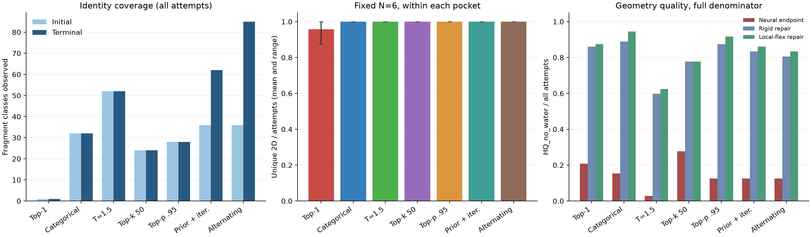

# 冻结权重自主生成多样性评测

正式测试 504 次，六个已查看口袋 × 12 种子 × 七种策略；pilot 的 14 次独立保留。所有原始尝试均入分母；一次尝试只输出 k=1 候选，不补抽、不删重复、不按质量筛选。仅使用一张 A100（CUDA_VISIBLE_DEVICES=0），未训练、未改任何权重，历史目录保持原样。

预定义的标准全概率抽样相对 Top-1：2D 构造 Unique 46→52，Morgan 内部多样性 0.2898→0.8523；网络 HQ 15/72→11/72，差 -5.6 个百分点；柔性 HQ 63/72→68/72。有效连通 72/72→72/72。

| 策略 | 尝试 | 有效连通 | 2D Unique | Unique/尝试 | Morgan内部多样性 | 网络HQ | 刚性HQ | 局部柔性HQ |
| --- | --- | --- | --- | --- | --- | --- | --- | --- |
| mask_top1 | 72 | 72 | 46 | 0.639 | 0.290 | 15 | 62 | 63 |
| mask_categorical | 72 | 72 | 52 | 0.722 | 0.852 | 11 | 64 | 68 |
| mask_temp15 | 72 | 72 | 46 | 0.639 | 0.849 | 2 | 43 | 45 |
| mask_topk50 | 72 | 72 | 50 | 0.694 | 0.853 | 20 | 56 | 56 |
| mask_topp095 | 72 | 72 | 47 | 0.653 | 0.854 | 9 | 63 | 66 |
| joint_prior_iterative | 72 | 72 | 71 | 0.986 | 0.874 | 9 | 60 | 62 |
| alternating_categorical | 72 | 72 | 72 | 1.000 | 0.878 | 9 | 58 | 60 |

本轮Top-1身份仍全部为苯，但完整二维图已有46种：其中包含N变化与连接/位姿闭环带来的图差异。故“苯身份重复”和“完整分子只有一种”必须分开；历史只有一种构造是旧固定N/单次解码策略的有限结果。本轮随机策略的主要收益包括不同片段组合与指纹结构覆盖，不能只用二维Unique数量概括。

高质量且唯一的构造产出如下，去重只用于计算指标，全部输出与重复都保留：

| 策略 | 有效唯一/尝试 | 网络HQ唯一/尝试 | 刚性HQ唯一/尝试 | 柔性HQ唯一/尝试 |
| --- | --- | --- | --- | --- |
| mask_top1 | 46/72 (63.9%) | 11/72 (15.3%) | 39/72 (54.2%) | 40/72 (55.6%) |
| mask_categorical | 52/72 (72.2%) | 9/72 (12.5%) | 49/72 (68.1%) | 49/72 (68.1%) |
| mask_temp15 | 46/72 (63.9%) | 2/72 (2.8%) | 33/72 (45.8%) | 35/72 (48.6%) |
| mask_topk50 | 50/72 (69.4%) | 16/72 (22.2%) | 44/72 (61.1%) | 44/72 (61.1%) |
| mask_topp095 | 47/72 (65.3%) | 7/72 (9.7%) | 44/72 (61.1%) | 45/72 (62.5%) |
| joint_prior_iterative | 71/72 (98.6%) | 8/72 (11.1%) | 59/72 (81.9%) | 61/72 (84.7%) |
| alternating_categorical | 72/72 (100.0%) | 9/72 (12.5%) | 58/72 (80.6%) | 60/72 (83.3%) |

2D Unique 是 RDKit Cleanup、移除 atom map、保留电荷/组分后去立体标签的构造 SMILES。含立体标签 Unique 单列 CSV。Morgan radius=2、2048 bits、chirality off，Internal Diversity 是所有有效输出对的平均 1−Tanimoto，重复样本参与统计；去重结构上的指标也单列，不混淆二者。Scaffold 用 Murcko，计数/比例在 CSV。未把不同 3D 构象计作不同 2D 分子。

## 身份与口袋条件

| 策略 | 初始/终态类数 | 模型熵 | 模型Top1概率 | 实际初始采样熵 | 3577初始/终态占比 | 初始/终态组合数 |
| --- | --- | --- | --- | --- | --- | --- |
| mask_top1 | 1/1 | 4.347 | 0.122 | 0.000 | 1.000/1.000 | 3/3 |
| mask_categorical | 32/32 | 4.347 | 0.122 | 4.347 | 0.091/0.091 | 12/12 |
| mask_temp15 | 52/52 | 4.347 | 0.122 | 6.176 | 0.076/0.076 | 12/12 |
| mask_topk50 | 24/24 | 4.347 | 0.122 | 3.301 | 0.106/0.106 | 12/12 |
| mask_topp095 | 28/28 | 4.347 | 0.122 | 3.995 | 0.091/0.091 | 12/12 |
| joint_prior_iterative | 36/62 | 4.347 | 0.122 | 4.607 | 0.076/0.126 | 12/67 |
| alternating_categorical | 36/85 | 4.347 | 0.122 | 4.607 | 0.076/0.126 | 12/72 |

GEOM 身份头没有受体输入，初始相同种子的身份跨口袋相同，概率在1e-6绝对容差内一致；证据见 CROSS_POCKET_COMPARISON.csv。它能在不同随机策略下产生不同组合，但不能称为已实现口袋条件化身份预测。当前连接头也没有直接蛋白特征；口袋进入官方位姿网络，再经几何反馈可能影响后期连接或交替身份。这种差异不证明结合活性、选择性或泛化。

所有口袋均是此前检查过的诊断数据；未在这六个口袋调参，未做独立开发集参数搜索，也没有未见口袋验证。每口袋完整指标如下，不能仅凭跨口袋混合值评估多样性：

| 策略 | 口袋 | 有效连通 | 2D Unique | 内部多样性 | 网络HQ | 柔性HQ |
| --- | --- | --- | --- | --- | --- | --- |
| mask_top1 | 12AV | 12 | 12 | 0.254 | 0 | 8 |
| mask_top1 | 7ILZ | 12 | 10 | 0.326 | 1 | 11 |
| mask_top1 | 9RT3 | 12 | 11 | 0.230 | 1 | 11 |
| mask_top1 | 9SYL | 12 | 10 | 0.304 | 6 | 12 |
| mask_top1 | 9T4A | 12 | 12 | 0.271 | 1 | 10 |
| mask_top1 | 9T51 | 12 | 11 | 0.341 | 6 | 11 |
| mask_categorical | 12AV | 12 | 12 | 0.886 | 1 | 12 |
| mask_categorical | 7ILZ | 12 | 12 | 0.886 | 0 | 11 |
| mask_categorical | 9RT3 | 12 | 12 | 0.884 | 1 | 10 |
| mask_categorical | 9SYL | 12 | 12 | 0.875 | 1 | 12 |
| mask_categorical | 9T4A | 12 | 12 | 0.882 | 2 | 12 |
| mask_categorical | 9T51 | 12 | 12 | 0.882 | 6 | 11 |
| mask_temp15 | 12AV | 12 | 12 | 0.881 | 0 | 6 |
| mask_temp15 | 7ILZ | 12 | 12 | 0.883 | 0 | 5 |
| mask_temp15 | 9RT3 | 12 | 12 | 0.882 | 0 | 7 |
| mask_temp15 | 9SYL | 12 | 12 | 0.876 | 2 | 9 |
| mask_temp15 | 9T4A | 12 | 12 | 0.884 | 0 | 10 |
| mask_temp15 | 9T51 | 12 | 12 | 0.888 | 0 | 8 |
| mask_topk50 | 12AV | 12 | 12 | 0.881 | 4 | 11 |
| mask_topk50 | 7ILZ | 12 | 12 | 0.888 | 0 | 6 |
| mask_topk50 | 9RT3 | 12 | 12 | 0.881 | 2 | 7 |
| mask_topk50 | 9SYL | 12 | 12 | 0.884 | 6 | 12 |
| mask_topk50 | 9T4A | 12 | 12 | 0.888 | 2 | 8 |
| mask_topk50 | 9T51 | 12 | 12 | 0.875 | 6 | 12 |
| mask_topp095 | 12AV | 12 | 12 | 0.879 | 0 | 11 |
| mask_topp095 | 7ILZ | 12 | 12 | 0.879 | 1 | 10 |
| mask_topp095 | 9RT3 | 12 | 12 | 0.884 | 0 | 12 |
| mask_topp095 | 9SYL | 12 | 12 | 0.890 | 3 | 10 |
| mask_topp095 | 9T4A | 12 | 12 | 0.886 | 2 | 12 |
| mask_topp095 | 9T51 | 12 | 12 | 0.879 | 3 | 11 |
| joint_prior_iterative | 12AV | 12 | 12 | 0.888 | 1 | 9 |
| joint_prior_iterative | 7ILZ | 12 | 12 | 0.872 | 0 | 10 |
| joint_prior_iterative | 9RT3 | 12 | 12 | 0.868 | 1 | 11 |
| joint_prior_iterative | 9SYL | 12 | 12 | 0.898 | 2 | 11 |
| joint_prior_iterative | 9T4A | 12 | 12 | 0.888 | 3 | 10 |
| joint_prior_iterative | 9T51 | 12 | 12 | 0.877 | 2 | 11 |
| alternating_categorical | 12AV | 12 | 12 | 0.893 | 1 | 10 |
| alternating_categorical | 7ILZ | 12 | 12 | 0.891 | 0 | 9 |
| alternating_categorical | 9RT3 | 12 | 12 | 0.861 | 2 | 11 |
| alternating_categorical | 9SYL | 12 | 12 | 0.882 | 2 | 10 |
| alternating_categorical | 9T4A | 12 | 12 | 0.868 | 2 | 11 |
| alternating_categorical | 9T51 | 12 | 12 | 0.884 | 2 | 9 |

固定N=6的同口袋种子比较如下；N=4/5/6的全部分层见PER_N_DIVERSITY.csv。此表控制大小与口袋混合的影响，平均值只作为六个已查看口袋的描述统计，不作独立泛化推断。

| 策略 | 固定N=6每口袋平均Unique/尝试 | 固定N=6每口袋平均内部多样性 |
| --- | --- | --- |
| mask_top1 | 0.958 | 0.284 |
| mask_categorical | 1.000 | 0.866 |
| mask_temp15 | 1.000 | 0.882 |
| mask_topk50 | 1.000 | 0.878 |
| mask_topp095 | 1.000 | 0.865 |
| joint_prior_iterative | 1.000 | 0.868 |
| alternating_categorical | 1.000 | 0.872 |

## 几何质量与修复代价

| 策略 | 阶段 | 蛋白碰撞通过/全部尝试 | HQ/全部尝试 | 异常跨片段键 | 异常跨片段角 | 修复RMSD均值Å | 最大原子位移Å |
| --- | --- | --- | --- | --- | --- | --- | --- |
| mask_top1 | native_final | 47/72 (65.3%) | 15/72 (20.8%) | 7 | 9 | NA | NA |
| mask_top1 | rigid | 66/72 (91.7%) | 62/72 (86.1%) | 4 | 1 | 0.417 | 2.661 |
| mask_top1 | local_flex | 67/72 (93.1%) | 63/72 (87.5%) | 2 | 3 | 0.402 | 2.650 |
| mask_categorical | native_final | 49/72 (68.1%) | 11/72 (15.3%) | 3 | 11 | NA | NA |
| mask_categorical | rigid | 68/72 (94.4%) | 64/72 (88.9%) | 0 | 0 | 0.417 | 2.463 |
| mask_categorical | local_flex | 69/72 (95.8%) | 68/72 (94.4%) | 0 | 1 | 0.407 | 2.445 |
| mask_temp15 | native_final | 37/72 (51.4%) | 2/72 (2.8%) | 17 | 35 | NA | NA |
| mask_temp15 | rigid | 60/72 (83.3%) | 43/72 (59.7%) | 14 | 19 | 0.492 | 2.360 |
| mask_temp15 | local_flex | 62/72 (86.1%) | 45/72 (62.5%) | 13 | 17 | 0.473 | 2.342 |
| mask_topk50 | native_final | 58/72 (80.6%) | 20/72 (27.8%) | 11 | 8 | NA | NA |
| mask_topk50 | rigid | 70/72 (97.2%) | 56/72 (77.8%) | 3 | 3 | 0.404 | 2.288 |
| mask_topk50 | local_flex | 70/72 (97.2%) | 56/72 (77.8%) | 3 | 3 | 0.394 | 2.332 |
| mask_topp095 | native_final | 50/72 (69.4%) | 9/72 (12.5%) | 11 | 16 | NA | NA |
| mask_topp095 | rigid | 70/72 (97.2%) | 63/72 (87.5%) | 6 | 5 | 0.422 | 2.313 |
| mask_topp095 | local_flex | 70/72 (97.2%) | 66/72 (91.7%) | 6 | 6 | 0.409 | 2.295 |
| joint_prior_iterative | native_final | 49/72 (68.1%) | 9/72 (12.5%) | 35 | 44 | NA | NA |
| joint_prior_iterative | rigid | 67/72 (93.1%) | 60/72 (83.3%) | 2 | 3 | 0.475 | 2.150 |
| joint_prior_iterative | local_flex | 68/72 (94.4%) | 62/72 (86.1%) | 1 | 3 | 0.463 | 2.118 |
| alternating_categorical | native_final | 41/72 (56.9%) | 9/72 (12.5%) | 35 | 44 | NA | NA |
| alternating_categorical | rigid | 66/72 (91.7%) | 58/72 (80.6%) | 5 | 6 | 0.482 | 2.067 |
| alternating_categorical | local_flex | 67/72 (93.1%) | 60/72 (83.3%) | 2 | 2 | 0.470 | 2.070 |

沿用 HQ_no_water 的 12 条必要条件及 PB 剩余 20 条输出，原 UFF 50 构象能量参考、碰撞比值、键角/环/立体阈值不变，只去掉两项水检查；缺失项不能当作通过。CSV 报告完整性与缺失数，all_quality_checks.json 保留所有失败和错误。两种修复独立从同一 native_final 出发，未串联；优化未收敛仍保留，绝不因未收敛删样。全部异常键角在 ABNORMAL_BONDS.csv / ABNORMAL_ANGLES.csv。

native_final 是联合推理在最后一次官方神经运动后的坐标、未做 MMFF 修复；它仍包含之前合法图搜索和参考形状转移的贡献，不能当作完全无约束的网络能力。decoded_initial 是初始化学图赋予随机片段坐标的读出；未连图的原始片段点云没有完整化学图，HQ/化学有效/连通等为 NA。每次初始及图更新参考投影误差在 result.json，更新阈值 .5Å，不能将投影计作神经改进。身份或图更新后，decoded_initial 与终态可能不是同一化学图，不能用原子索引直接算起终 RMSD；修复 RMSD 则严格基于相同终态图。

立体标签由当前坐标推导，与自身坐标一致不等于目标立体预测正确。没有目标立体标签输入；生成身份模板本有的立体特征属于词表，不是目标真值。相同立体分子、同口袋内的对齐和受体坐标系 RMSD 单列 CONFORMER_DIVERSITY.json，不影响 2D Unique。

## 生成有效性与预算

| 策略 | 初始连接头完整树 | 搜索成功 | 接受/拒绝更新 | 身份/连接/位姿前向 | 平均秒/尝试 | 原始生成失败 |
| --- | --- | --- | --- | --- | --- | --- |
| mask_top1 | 0 | 72 | 137/0 | 360/360/1728 | 41.335 | {} |
| mask_categorical | 6 | 72 | 117/20 | 360/360/1728 | 37.656 | {} |
| mask_temp15 | 0 | 72 | 116/40 | 360/360/1728 | 39.420 | {} |
| mask_topk50 | 0 | 72 | 119/21 | 360/360/1728 | 36.930 | {} |
| mask_topp095 | 0 | 72 | 111/10 | 360/360/1728 | 37.833 | {} |
| joint_prior_iterative | 0 | 72 | 178/50 | 360/360/1728 | 38.552 | {} |
| alternating_categorical | 0 | 72 | 263/25 | 360/360/1728 | 36.359 | {} |

拒绝的更新原因计数：{"ChemistryRejected('Reference transfer fit exceeds frozen 0.5 A bound')": 166}。逐次提议在ALL_UPDATE_EVENTS.csv，拒绝事件在REJECTED_UPDATE_EVENTS.csv，绝不把保留旧图当成成功接受新身份。

完整尝试均为五次身份查询、五次当前连接前向/同预算搜索、24 次官方位姿前向。一次身份策略的后四次身份查询只观察，不更新身份；各策略均在步 5/10/15/20 提议连接更新。早期失败提前停止并如实计消耗，拒绝更新保留上一合法图且事件全部留存。连接合法图依赖模板价态约束及 bounded beam，不能把合法搜索后的有效率说成原始连接头本身的有效率。每次搜索 SearchConfig 不变，k=1；搜索内部前缀去重属于冻结算法，未对输出分子做去重筛选。原始连接失败、无效输出、修复失败均可在逐次 CSV/JSON 追溯。

多进程只是共享同一 GPU 来并发 CPU 搜索/修复；平均秒数是并发环境下每次经过时间，求和不是总墙钟时长。多样性、有效唯一产出与质量始终一起报告，不以容易修复的重复苯结构获得高通过率。

## N、输入与 Novelty 边界

预定 N 先验是独立于目标的 Uniform{3,4,5,6}，种子规则见 frozen_plan.json。本轮每口袋实际分布 {'6': 48, '5': 12, '4': 12}，跨策略一致。只有 12 个独立 N 抽样，跨口袋复用；未抽到 N=3 如实保留。当前没有可用 N/停止头，人工先验不冒充自主预测。

直接读取去水 PDB，用官方 get_protein + structure_to_rdkit 得到模型口袋，以蛋白重原子均值作为中心，不加载 fixture、真实 N、配体 SDF/参考坐标/连接/立体标签。口袋区域本身来自已定义的历史结合位点，故不是未知位点搜索。QC/修复保留非水辅因子；官方模型沿用去 HETATM 协议，未感知这些辅因子，限制与旧实验相同。

原冻结基线仍为旧目录的 18 次固定 N5、90/90 苯、1 个构造、网络 HQ=4/18、修复 HQ=15/18，原记录和指纹保持不变。本轮 Top-1 采用相同一次身份规则，但 N、蛋白中心、连接更新不同，因此不得把历史与本轮 HQ 差说成严格配对模型改进。

仅对可用的旧 PDBBind 17,420 项训练索引计算部分 Novelty，索引 SHA 和范围见 novelty_reference.json。该索引不覆盖本轮 GEOM 身份、当前连接头及官方位姿模型的完整训练并集，因此完整 Novelty 不可评估。部分索引的未命中数单列 CSV，不能称为完整训练去重后的新颖性。未评估结合活性或实验成功。

相同初始输入的GPU身份概率存在约1e-7量级浮点差异，独立核验采用atol=1e-6、rtol=1e-5；配对初始身份实际一致。固定种子与协议保证可追溯重放，不宣称所有GPU概率逐比特一致。

冻结参数、全部权重 SHA 见 frozen_plan.json，概率 logits/分布、搜索池、失败、所有 SDF/spec、修复与逐项 QC 均保留。复现见 REPRODUCE.md；独立核验见 verification.json。

