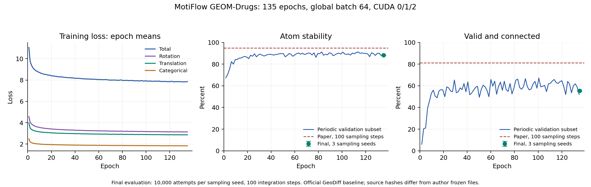

# MotiFlow GEOM-Drugs 复现实验

**训练与最终评估已完成，但尚未复现论文指标。** 本目录按用户要求归档为 `2611/1113`；
实验于 2026-11-13 启动，全部流程于 **2026-11-14 18:11（北京时间）**完成。

## 结果

同一模型，采样种子 0、1、2 各 **10,000 次尝试**，每次 **100 步**；下表为三个采样种子的均值 ± 样本标准差。

| 指标 | 本次 | 论文 GEOM-Drugs，100 步 |
|---|---:|---:|
| 原子稳定性 | 88.224% ± 0.060% | 95.0% ± 0.0% |
| 有效且连通比例 | 55.400% ± 0.606% | 81.2% ± 0.3% |
| 化学有效率 | 79.303% ± 0.533% | — |

论文：[3D Molecule Generation from Rigid Motifs via SE(3) Flows](https://arxiv.org/html/2601.16955v2)，表 2、表 7。
有效且连通共 **16,620 / 30,000**，化学有效共 **23,791 / 30,000**。
原子稳定性按全部被评估原子计；有效率和有效且连通比例按全部生成尝试计。
`connectivity_given_valid` 是有效样本中的连通比例，和上表按全部尝试计的指标分母不同。
这是一个模型的三个**采样**重复，训练随机种子只有 0。

## 实际训练与数据

- 官方仓库：[rpoletukhin/MotiFlow](https://github.com/rpoletukhin/MotiFlow)，固定提交 `5be946dd6d9489146d12580e9fe751ba2966f428`。
- CUDA 0、1、2，A100 80GB，三卡 DDP；全局 batch **64**，完整批次每卡 **22/21/21**。
- **135 epoch、416,070 次更新**，Adam，学习率 0.0001，梯度裁剪 1.0，训练 seed=0。
- 每轮使用全部 **197,220** 条片段化训练构象，共 26,624,700 条次；最后不足 64 的批次按实际数量计。
- GEOM 对齐：训练 197,220 / 199,950，验证 24,676 / 25,000；片段化后验证保留 24,671 条，5 条排除。
- alpha=0.1%；采样温度 1.0、remasking rate=1.5。batch=192 仅做过容量探针，本次正式训练始终为 64。
- 首轮/末轮平均总 loss：11.054 / 7.854；周期验证有波动，不能用 loss 下降替代生成质量结论。

## 已知差异与结论边界

1. 用户选择了官方 GeoDiff 包。两个源文件 SHA-256 与 MotiFlow 冻结清单不同；样本数量、源 SMILES、拓扑和坐标已审计，
   但与作者冻结文件的语义等价性尚未证明。原冻结清单未修改。
2. 旧版 PyG pickle 使用兼容读取器；对齐和模型主体使用上游实现。DDP 与原单卡运行的随机数消费不逐位相同。
3. 本地产生 **229 类几何片段**，论文 alpha=0.1% 的 GEOM 对应值为 **202 类**（论文表 4）。
   这是明确待排查差异，尚未确定其对指标差距的影响。
4. 表中指标来自原始生成帧的确定性原子重建与上游成键评估。MMFF strain 是评估统计，未用于替换或修复上述原始坐标。
   属性和 strain 使用上游有效且连通子集；原始数值完整保存在 JSON/CSV 中。

## 文件导航

| 文件 | 内容 |
|---|---|
| [metrics_summary.json](metrics_summary.json) | 全部最终指标及跨采样种子标准差 |
| [sampling_runs.csv](sampling_runs.csv) | 三个种子的原始评估行，保持原文件字节 |
| [training_progress.png](training_progress.png) | 训练 loss、周期验证和最终结果与论文的对照 |
| [epoch_loss.csv](epoch_loss.csv) | 135 轮训练统计 |
| [periodic_evaluation.csv](periodic_evaluation.csv) | 83 次周期评估；与最终 3×10,000 评估分开记录 |
| [training_config.yaml](training_config.yaml) | 本次训练实际解析的配置 |
| [verification.json](verification.json) | 完成状态、分母、checkpoint/采样/词表哈希与数据差异核验 |
| [reproduction_bundle.zip](reproduction_bundle.zip) | 本次执行时冻结的本地适配代码、精确环境、协议和小型审计证据 |
| [delivery_manifest.json](delivery_manifest.json) | 本目录有效载荷的大小和 SHA-256；清单不包含自身 |

完整原始数据、各 checkpoint、逐步训练日志、生成 `.pt` 和 SDF 保留在本地 `/data/zhouwanyao/motiflow`。
最终模型：`outputs/geom_ddp_seed0/checkpoints/step_416070_final.pth`，SHA-256 `660d507679b0e668a2201536b761003094111a3999c236c4032e76015b6ea596`。
归档中的本地绝对路径用于定位原始证据；上游代码通过固定提交获取，适配代码使用运行时冻结快照。
