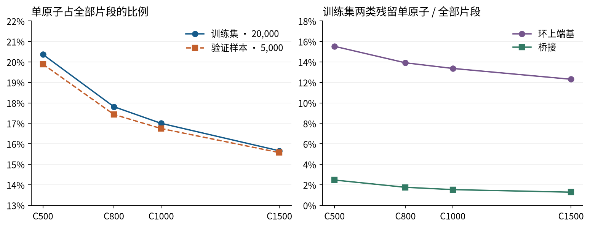

# C800、C1000 和 C1500 的片段覆盖

词表仍从原先的 20,000 个 ChEMBL train 分子挖掘，包含 558,922 个重原子。沿用 C500 的数据、核心身份、初始化和合并顺序，比较 8 种开关组合与全部独立单环对照。在 5,000 个独立 ChEMBL validation 分子上另行评估三项全开词表。

## 三项全开的结果

总单原子、桥接和环上端基三列均以**训练集全部输出片段 token** 为分母。重原子覆盖指至少含两个重原子的片段所覆盖的重原子比例。分子覆盖给出完全无需单原子回退的分子比例。

| 词表 | 全部 token | 单原子数 | 单原子占比 | 桥接 / token | 环上端基 / token | 多原子重原子覆盖 | 平均重原子 / 片段 | 无单原子分子 |
| --- | --- | --- | --- | --- | --- | --- | --- | --- |
| C500 | 139,565 | 28,426 | 20.37% | 2.47% | 15.53% | 94.91% | 4.005 | 6,901（34.51%） |
| C800 | 130,444 | 23,239 | 17.82% | 1.76% | 13.92% | 95.84% | 4.285 | 8,720（43.60%） |
| C1000 | 126,864 | 21,569 | 17.00% | 1.53% | 13.37% | 96.14% | 4.406 | 9,359（46.79%） |
| C1500 | 121,217 | 18,984 | 15.66% | 1.28% | 12.31% | 96.60% | 4.611 | 10,382（51.91%） |

## 每增加一批词位的实际收益

各次扩容的词位数不同。下表按每增加 100 个词位归一化，并统计相同分子前后是否真的少了单原子。所有方案、所有相邻容量下，每个新片段都由上一容量的完整片段合并而成。

| 扩容 | 减少单原子 | 其中桥接 | 其中环上端基 | 单原子占比下降（百分点） | 每 100 个新词位下降（百分点） | 少回退的训练分子 / 20,000 | 少回退的验证分子 / 5,000 |
| --- | --- | --- | --- | --- | --- | --- | --- |
| C500 → C800 | 5,187 | 1,153 | 3,518 | 2.55 | 0.851 | 4,468 | 1,127 |
| C800 → C1000 | 1,670 | 349 | 1,195 | 0.81 | 0.407 | 1,593 | 358 |
| C1000 → C1500 | 2,585 | 389 | 2,036 | 1.34 | 0.268 | 2,289 | 542 |

新增类型的支持度以扩容完成时使用该词项的不同训练分子记录数统计。同一分子内重复使用只计一次。部分词项是继续合并所需的中间片段，最终切分中的使用数可以为零。

| 新增词位区间 | 新增类型 | 有最终使用记录 | 最终仅 1–5 个分子使用 | 每个新词项的分子支持中位数 | 新词项的总 token 实例 |
| --- | --- | --- | --- | --- | --- |
| C500 → C800 | 300 | 299 | 16 | 25 | 8,678 |
| C800 → C1000 | 200 | 200 | 21 | 15 | 3,384 |
| C1000 → C1500 | 500 | 487 | 107 | 10 | 5,174 |

C1000 升至 C1500 时，减少的 2,585 个单原子中，2,036 个是环上端基（78.76%）。C1500 剩余 18,984 个单原子，其中环上端基 14,923 个，占残留单原子的 78.61%。

## 独立验证样本

在原有 scaffold / 父体分组划分的 validation 集合中，按种子 42 和分子 ID 的 SHA-256 排序，固定取前 5,000 个。与 20,000 个训练分子逐一核查，记录 ID、分子 ID、strict/loose 父体、家族和划分组的重叠均为 0。四种容量使用相同的验证分子。所有词表在评估前已经冻结。

| 词表 | 全部 token | 单原子数 | 单原子占比 | 多原子重原子覆盖 | 平均重原子 / 片段 | 无单原子分子 | 完整图重建 |
| --- | --- | --- | --- | --- | --- | --- | --- |
| C500 | 36,661 | 7,293 | 19.89% | 95.12% | 4.074 | 1,690（33.80%） | 5,000 / 5,000 |
| C800 | 34,288 | 5,979 | 17.44% | 96.00% | 4.356 | 2,142（42.84%） | 5,000 / 5,000 |
| C1000 | 33,426 | 5,598 | 16.75% | 96.25% | 4.468 | 2,287（45.74%） | 5,000 / 5,000 |
| C1500 | 32,057 | 4,992 | 15.57% | 96.66% | 4.659 | 2,534（50.68%） | 5,000 / 5,000 |

各容量保留相同的 51 种训练单原子身份。验证时遇到的词表外单原子按原始身份保留并计入单原子分母。C1500 共 3 个此类实例，分布在 3 个分子中，[n-] 有 1 个、[s+] 有 2 个。图重建使用这些原子的原始身份和实例元数据。[词表外原子明细](results/capacity/validation_unknown_atoms.csv)

本次比较衡量冻结片段表示的覆盖与化学图重建。SigmaDock 的训练稳定性、构象误差和对接准确率仍需通过下游实验测量。

## 相同容量的开关组合

下表为训练集单原子 token 占比。主方案初始化采用出现至少两次的独立单环和全部匹配官能团，另一行对照预打包全部独立单环。两种初始化各自延续先前 C500。

| 启用改造 | C500 | C800 | C1000 | C1500 |
| --- | --- | --- | --- | --- |
| 原版 C | 38.17% | 37.38% | 37.06% | 36.44% |
| 内生刚性 | 22.28% | 20.57% | 19.72% | 18.38% |
| 尺寸惩罚 | 38.07% | 37.33% | 37.08% | 36.53% |
| 环与 SMARTS 初始化 | 38.56% | 37.43% | 36.94% | 36.33% |
| 内生刚性 + 尺寸 | 20.61% | 18.67% | 17.89% | 16.71% |
| 内生刚性 + 初始化 | 21.74% | 18.87% | 18.04% | 16.49% |
| 尺寸 + 初始化 | 38.42% | 37.34% | 36.98% | 36.40% |
| 三项全开 | 20.37% | 17.82% | 17.00% | 15.66% |
| 三项全开，全部独立单环 | 21.56% | 18.16% | 17.27% | 15.76% |

在这批训练分子上，C800 的最低单原子占比为 17.82%（三项全开）、C1000 的最低单原子占比为 17.00%（三项全开）、C1500 的最低单原子占比为 15.66%（三项全开）。固定三项全开设置，C1000 到 C1500 在独立验证样本上再降低 1.18 个百分点。

## 剩余单原子的拓扑位置

每格为训练集实例数（占该容量全部单原子）。重原子度为 0 的独立组分单列。

| 原分子位置 | C500 | C800 | C1000 | C1500 |
| --- | --- | --- | --- | --- |
| 桥接 | 3,443（12.11%） | 2,290（9.85%） | 1,941（9.00%） | 1,552（8.18%） |
| 环上端基 | 21,672（76.24%） | 18,154（78.12%） | 16,959（78.63%） | 14,923（78.61%） |
| 非环端基 | 1,813（6.38%） | 1,538（6.62%） | 1,447（6.71%） | 1,349（7.11%） |
| 分叉枢纽 | 484（1.70%） | 243（1.05%） | 208（0.96%） | 146（0.77%） |
| 零度孤立原子 | 1,014（3.57%） | 1,014（4.36%） | 1,014（4.70%） | 1,014（5.34%） |

## 核验与文件

27 / 27 个新快照逐个达到 20,000 / 20,000 完整化学图重建。每种设置的初始词表及前序合并与原 C500 逐项相同。三项全开的三个新快照还从原始 SMILES 独立重放了全部训练分子，切分逐一相同，逐键检查发现 0 个违反内生刚性规则的转子。沿用上一轮游离 TRP、TYR 等 7 个示例，四种容量都通过图重建。[词表前缀与分区核验](results/capacity/prefix_audit.json) · [重放及刚性核验](results/capacity/optimized/replay.json) · [药物与氨基酸示例](results/capacity/examples.csv)

完整数据包括全部开关组合、统计分母、配对收益和 Top-10 单原子环境。[训练集全部指标](results/capacity/comparison.csv) · [扩容增益](results/capacity/marginals.csv) · [各拓扑 Top-10](results/capacity/top10_all.csv) · [验证集指标](results/capacity/validation.csv) · [验证样本与划分核查](results/capacity/validation_audit.json)
